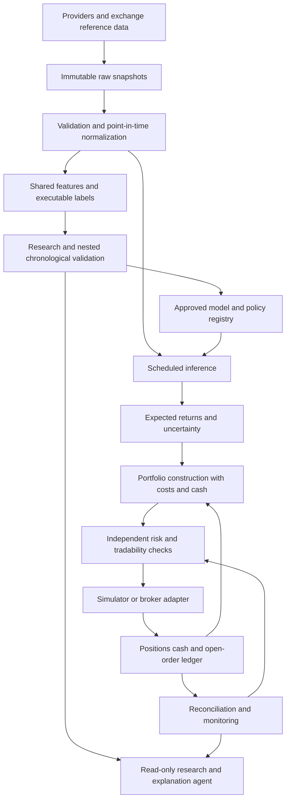

# Quant Agent: Code Review, Quantitative Design Analysis, and Handover

Review date: 12 November 2026 (Asia/Shanghai)  
Project reviewed: `F:\quant agent\quant_project`  
Purpose: establish what the existing implementation actually does, assess the validity of its quantitative evidence, and specify a defensible replacement architecture.

## 1. Scope, method, and evidence boundaries

The review proceeds from inventory and observed behavior to algorithmic analysis, then architecture and implementation recommendations. Conclusions appear last.

All 17 Python sources were examined, all 11 CSV files were structurally audited, all four JSON outputs were read, and model/feature/chart artifacts were inventoried and hashed. Two representative charts were visually inspected: `short_focus_oos.png` and `optimized_portfolio.png`. The remaining charts were inventoried, not independently validated. Empty directories and absent engineering infrastructure were also checked.

Evidence is classified as:

- **Confirmed source defect:** follows directly from the current source and, where applicable, an arithmetic counterexample.
- **Observed artifact fact:** measured from the supplied files; does not establish historical runtime behavior or market-data authenticity.
- **Design risk:** a missing safeguard or untested assumption; its financial impact requires a corrected experiment.

The available Python interpreter is 3.14.7 and lacks NumPy, pandas, SciPy, and XGBoost. Full training, inference, and backtests were therefore **not executed**. No model pickle was deserialized, provider request made by project code, AI service invoked, or order submitted. Syntax parsing and standard-library checks ran successfully. Arithmetic reproductions are deliberately distinguished from executing the actual numerical libraries.

Supporting artifacts:

- [Audit evidence and complete original-file manifest](<F:/quant agent/quant_project/handover/audit_evidence.json>): sizes, SHA-256 hashes, data profiles, duplicate artifacts, and counterexamples.
- [Reproducible audit checks](<F:/quant agent/quant_project/handover/audit_checks.py>): read-only checks using the Python standard library.

To regenerate the evidence, run from the project directory:

```powershell
python handover/audit_checks.py | Set-Content -Encoding utf8 handover/audit_evidence.json
```

The original strategy files were not changed. This review does not estimate corrected strategy profitability: the current results cannot supply that estimate reliably.

## 2. Project overview and directory structure

### 2.1 Inventory

Before this handover was added, the folder contained **70 files**: 17 Python sources, 11 CSVs, 16 model pickles, 12 text artifacts, four JSON outputs, nine PNG charts, and one compiled Python cache file.

```text
quant_project/
├── train_model.py                 Single-stock US classifier and threshold search
├── multi_stock_train.py           Pooled US classifier and per-stock sizing search
├── A_stock_pool_train.py          Independent A-share models on a fixed pool
├── today_decision.json            Older decision schema and missing-model error
├── configs/                      Empty
├── notebooks/                    Empty
├── data/
│   ├── download_us_data.py        US downloader, misplaced relative to root logic
│   ├── GOOGL.csv                 Separate longer-history GOOGL dataset
│   ├── us/                       AAPL, AMZN, GOOGL, MSFT CSVs
│   └── cn/                       000001.SZ, 300975.SZ, 600036.SH,
│                                 600519.SH, 603773.SH, 603986.SH CSVs
├── models/
│   ├── us/                       Eight pickles, four feature lists
│   └── cn/                       Three pickles, three feature lists
├── scripts/
│   ├── data/stock_selector.py     Current-universe factor ranking
│   ├── training/
│   │   ├── individual_models.py  Independent US classifiers and backtests
│   │   ├── tune_googl.py         Label/model/trading-parameter search
│   │   ├── portfolio_backtest.py Replays saved US models
│   │   ├── train_a_stock.py      One A-share classifier
│   │   ├── batch_train_a_stocks.py Three A-share classifiers
│   │   └── ...                   Two pickles, two feature lists, two charts
│   ├── validation/
│   │   ├── walk_forward_validation.py  Long/short rolling evaluation
│   │   ├── robust_walk_forward_short.py Long-only rolling evaluation
│   │   └── ...                   Two saved charts
│   └── live/
│       ├── live_strategy.py      US retraining, threshold selection, signal JSON
│       ├── trade_engine.py       A-share rule signals and allocation JSON
│       ├── portfolio_optimizer.py Linear allocation solver
│       ├── deepseek_agent.py     US example-feature model/LLM wrapper
│       ├── orchestrator.py       A-share example-feature model/LLM/CLI wrapper
│       └── ...                   Three pickles, three thresholds, signals, cache
└── outputs/                      Five charts, selected stocks, older decisions
```

No README, dependency manifest/lockfile, package definition, automated test suite, broker adapter, position ledger, or experiment registry was found inside the reviewed folder. This is a statement about this folder, not about systems that might exist elsewhere.

### 2.2 Actual component relationships

There are several largely separate workflows:

1. **US research:** CSV/download → repeated feature functions → XGBoost → threshold/sizing search → approximate return series → charts/model files.
2. **A-share research:** CSV → the same feature family → one-day classifier → long-only backtest → model/chart files.
3. **US signal script:** local data at an old absolute path → model training → validation threshold → latest signal JSON.
4. **A-share decision script:** selected-stock JSON → local CSVs → handwritten indicator votes → linear allocation → decision JSON.
5. **Language-model commentary:** a stored model evaluated on hard-coded example inputs → DeepSeek → optionally Claude CLI → prose.

The A-share decision engine does not load the trained A-share classifier. Its `MODEL_DIR` is defined but unused. The orchestrator does not orchestrate stock selection, market-data refresh, training, portfolio construction, and execution; it chains two commentary tools. No source establishes a complete broker execution loop.

## 3. Data and artifact examination

### 3.1 Dataset coverage

| Dataset | Rows | Earliest date | Latest date | Observations |
|---|---:|---|---|---|
| US AAPL, AMZN, GOOGL, each | 508 | 2024-03-01 | 2026-03-11 | Ascending dates; short research history |
| US MSFT | 1,865 | 2019-01-02 | 2026-06-03 | Integer date format; not ascending |
| Separate `data/GOOGL.csv` | 1,865 | 2019-01-02 | 2026-06-03 | Different location, schema, and coverage from US GOOGL |
| CN 000001, 600036, 600519, 603773, each | 1,792 | 2019-01-02 | 2026-05-27 | Integer dates; not ascending |
| CN 603986 | 1,791 | 2019-01-02 | 2026-05-27 | One fewer row than the longer CN histories |
| CN 300975 | 1,234 | 2021-04-21 | 2026-05-27 | Shorter available history |

No duplicate dates or missing/nonfinite required OHLCV values were found by the audit. This does **not** validate exchange calendars, corporate actions, volume units, vendor accuracy, or completeness of trading sessions.

Three rows fail OHLC consistency:

- [AMZN CSV, line 485](<F:/quant agent/quant_project/data/us/AMZN.csv:485>): 2026-02-04 open 238.86 exceeds high 238.77.
- [AMZN CSV, line 491](<F:/quant agent/quant_project/data/us/AMZN.csv:491>): 2026-02-12 open 203.96 exceeds high 203.88.
- [GOOGL CSV, line 483](<F:/quant agent/quant_project/data/us/GOOGL.csv:483>): 2026-02-02 open 334.32 is below low 335.63.

These may reflect inconsistent adjustments or bad source values; the files alone do not identify the cause. They should be quarantined and reconciled against a documented source, not silently repaired by clipping.

### 3.2 Data-path and freshness failures

**Downloader destination mismatch.** [Downloader lines 6–9](<F:/quant agent/quant_project/data/download_us_data.py:6>) ascend two directories despite the file residing directly in `data/`. The resolved output is `F:\quant agent\data\us`, outside the reviewed project. Updating data through this script would not update the expected project US folder.

**Legacy paths remain active.** Examples include [live strategy line 22](<F:/quant agent/quant_project/scripts/live/live_strategy.py:22>), both validators at line 22, [batch training lines 22–24](<F:/quant agent/quant_project/scripts/training/batch_train_a_stocks.py:22>), and the root training scripts. Defining new project-root constants elsewhere does not replace these active legacy paths.

**Selection does not provision its consumers.** The saved selection dated 2026-06-19 contains 600549.SH, 600160.SH, 000630.SZ, 300502.SZ, and 600221.SH. None has a CSV under `data/cn`. The selector fetches data to compute ranks but does not persist those bars. [Trade-engine selection loading](<F:/quant agent/quant_project/scripts/live/trade_engine.py:21>) accepts this list; its loader then reads absent files. With the supplied state and dependencies available, the main decision path would fail on missing selected-symbol data.

**No freshness contract.** The datasets end months before the review date. Signal outputs use May dates; the root decision and output-directory decision differ in timestamp, capital, and schema. The saved output decision lacks the current source's `optimized_orders` field. These are historical artifacts, not evidence of a successful current run.

### 3.3 Adjustment and schema problems

Several loaders select only date/OHLCV columns and then test for `adj_factor`, which has already been discarded. See [batch loader lines 65–75](<F:/quant agent/quant_project/scripts/training/batch_train_a_stocks.py:65>), [individual loader lines 84–95](<F:/quant agent/quant_project/scripts/training/individual_models.py:84>), and [live loader lines 73–83](<F:/quant agent/quant_project/scripts/live/live_strategy.py:73>). Their advertised adjustment branches cannot run. In the short validator, an adjustment block additionally appears after indicators have been calculated; simply retaining the column would not fix that ordering.

The trade engine, by contrast, retains and applies adjustment factors before indicators. Training and decisions therefore do not share a price convention. The magnitude of resulting discrepancies depends on the stored factors and source adjustment status.

[Pooled US download lines 45–55](<F:/quant agent/quant_project/multi_stock_train.py:45>) replace column names by position. This assumes provider output order; it can mislabel OHLCV columns or fail when the number of returned columns changes. Name-based selection is required.

Some loaders parse integer `YYYYMMDD` explicitly; others call `pd.to_datetime` without a format, allowing integers to be interpreted as epoch offsets. The main US validator has that vulnerability if pointed at integer-date files. One date schema must be enforced at ingestion.

### 3.4 Artifact provenance

Byte-identical copies exist for the live models in two directories, the 603986 model in two directories, and the tuned GOOGL model in three paths. `high_return_model.pkl` is identical to `model_AAPL.pkl`. Nine feature-list files are identical, but contain only names, not definitions, label semantics, fit dates, or data provenance.

The short walk-forward chart visibly spans approximately 2022–2026. Its configured three US files each contain only 508 rows, while the script needs 1,125 rows before feature warm-up. The other validator requires 1,200 rows; live training requires 875. None can produce those workflows from these three bundled files. The old external paths may explain the mismatch, but their contents were outside review scope. Chart appearance cannot resolve provenance.

## 4. Core model and strategy analysis

### 4.1 Intended statistical model

The recurring feature set has 17 variables: MA5/10/20, MACD and histogram, K/D/J, RSI, Bollinger width/position, 5/20-day volatility, close relative to MA20, volume ratio, and 7/14-day rate of change. Most models are shallow XGBoost classifiers with 200 trees, depth 3, learning rate 0.05, and subsampling. The pooled model differs; GOOGL searches a parameter grid.

The principal US label is:

```text
Y[t] = 1 if Close[t+2] / Close[t] - 1 > 1%, else 0
```

A-share variants use `t+1`. Models estimate this event's probability; trading scripts turn the estimate into long/flat or long/short positions. Some scripts optimize thresholds, others use 0.5. The horizon and cutoff are not carried with saved model artifacts.

### 4.2 Unknown future returns become negative labels

[Root label construction and cleaning](<F:/quant agent/quant_project/train_model.py:97>) calculate a shifted return, compare it with 0.01, cast to integer, and drop missing values in features plus `target`. A missing future return compares false and becomes **0**, so the final two US rows or final A-share row survive as fabricated negative outcomes.

This pattern recurs across training and validation. The standard-library reproduction verifies the NaN comparison behavior. It primarily corrupts evaluation tails and could contaminate fitting if all labeled rows are later used. Valid inference rows must remain available separately from training rows; eligibility for training requires a known, matured target return.

### 4.3 Adjacent splits lack label-availability separation

Time ordering is present, which is useful, but the final training labels use future prices in the adjacent validation/test interval. In the direct 80/20 split, the last two US training labels extend into the test period. Rolling splits also lack an explicit label-maturity check.

The exact deployability boundary depends on the declared fit and decision timestamps. That schedule is absent. A sound split requires every fitting label to have matured before fitting, and any calibration/policy selection to finish before test trading begins. For panel data, splitting by row count can also split one date across partitions; use date groups and explicit label intervals.

Chronological split tools support a gap, but a generic row gap is not a substitute for instrument-aware label timing. [Scikit-learn TimeSeriesSplit documentation](https://scikit-learn.org/stable/modules/generated/sklearn.model_selection.TimeSeriesSplit).

### 4.4 Probability of exceeding 1% is not a direction forecast or expected return

The code frequently describes the model output as an “up probability.” It actually estimates an event such as a two-day return above 1%. The complement includes losses, flat outcomes, and gains below 1%. Therefore `p < 1 - threshold` does not establish a profitable short opportunity.

Likewise, an 80% chance of a small gain can have a negative expected return if the remaining outcomes are sufficiently adverse. For illustration, 80% at +1% and 20% at −8% gives expected return −0.8% before costs. Probability alone is an unsuitable portfolio objective.

The two-day US label is also evaluated using positions recomputed daily against one-day returns. A multi-day forecast can legitimately drive daily rebalancing, but only with a specified holding policy and measured mapping from that forecast to daily portfolio decisions. That specification and validation are missing here.

### 4.5 Test-set optimization and search bias

[Root search lines 146–191](<F:/quant agent/quant_project/train_model.py:146>) choose trading parameters on the same test interval used to report final returns. [Individual-model search](<F:/quant agent/quant_project/scripts/training/individual_models.py:201>) and [pooled search](<F:/quant agent/quant_project/multi_stock_train.py:209>) repeat the pattern.

[GOOGL tuning](<F:/quant agent/quant_project/scripts/training/tune_googl.py:118>) compares four label cutoffs, 32 model configurations per cutoff, and multiple trading thresholds/scales against the same 20% interval. That is 128 model fits with repeated policy selection. The winning model is written over `model_GOOGL.pkl`, while consumers manually hard-code trading parameters and do not preserve the selected label cutoff. Later use of that model on the same period does not restore independence.

These are development results, not untouched test evidence. Repeated search creates selection bias even when each model's fit uses only earlier observations. The relevant methodological issue is described in [Bailey et al., The Probability of Backtest Overfitting](https://www.davidhbailey.com/dhbpapers/backtest-prob.pdf). No probability-of-overfitting estimate was calculated for this project.

### 4.6 Scaling mismatch and invalid pooled aggregation

[Pooled training lines 151–177](<F:/quant agent/quant_project/multi_stock_train.py:151>) fit on `X_train_scaled`, evaluate classification on `X_test_scaled`, then generate trading probabilities from **unscaled `X_test`**. Thus the accuracy and trading report evaluate different input representations. A fitted transformation must be part of the prediction pipeline. Standardizing a tree model is usually unnecessary; its presence here creates a correctness obligation regardless.

[Pooled aggregation lines 255–261](<F:/quant agent/quant_project/multi_stock_train.py:255>) concatenate each stock's returns using retained global row indices, not dates. Stock A and stock B occupy different rows. Averaging across columns consequently yields individual stock observations rather than simultaneous daily portfolio returns. Cumulative returns and annualized metrics then operate on the wrong time unit.

### 4.7 Ineffective scale search and overlapping decision regions

For the discrete strategies, positions are −1, 0, or +1, multiplied by a scale at least 1 and clipped to [−1, 1]. Every tested scale yields the same positions. The reported optimal scale is merely a tie-breaking artifact. This does not apply to the pooled script's continuous sizing formula, where scale can change exposure.

At thresholds below 0.5, long and short conditions overlap. For example, at threshold 0.45, a probability of 0.50 satisfies both. Sequential assignments make the short assignment win. GOOGL's plotting expression instead subtracts two indicators and returns zero in that region ([plotting line 276](<F:/quant agent/quant_project/scripts/training/tune_googl.py:276>)). Search results and charts can therefore represent different policies.

### 4.8 Feature and evaluation limitations

Absolute moving averages, MACD, and unnormalized band width encode nominal price scales. Pooled training can learn ticker/price-level associations rather than a portable relationship. Global standardization does not make those ratios invariant to price units or changing adjustment anchors. Many indicators also reuse the same price information; seventeen features do not establish seventeen independent signals.

Accuracy alone is inadequate for a rare-event label. The code lacks base-rate comparisons, reliability diagrams, class-conditional returns, uncertainty estimates, and out-of-sample calibration checks. Brier score and log loss should accompany reliability curves; neither scalar score isolates calibration by itself. [Scikit-learn calibration documentation](https://scikit-learn.org/stable/modules/calibration.html).

No economic hypothesis, ablation study, benchmark-relative attribution, or documented search ledger establishes why the feature set should earn a persistent net return. This is an evidence gap, not proof that technical-price features cannot work.

## 5. Backtest and validation analysis

### 5.1 Execution timing remains unproved

The common calculation is `position.shift(1) * log_return`. This avoids directly multiplying today's prediction by today's return, but still implicitly obtains yesterday's closing price after using yesterday's final close to form the signal. A realizable closing-auction schedule is not specified. For after-close daily signals, next-session execution must be modeled, including the overnight gap and whatever holding period the label represents.

Turnover costs are attached to current target changes, while returns use prior target exposure. That can describe a precise close-rebalance convention, but it needs an event timeline and initial/final inventory accounting. The first row's missing shifted position and turnover are dropped; opening trades, cross-window holdings, and terminal liquidation are not consistently represented.

### 5.2 Log returns are treated as portfolio wealth changes

Most scripts call `sum(strategy_ret_net) * 100` cumulative percentage return, and differences of cumulative sums percentage drawdown. Even for a fully invested single long position, cumulative log return must be exponentiated to get compounded return. For changing weights, shorts, and transaction costs, multiplying asset log return by weight is not an exact portfolio return.

For an idealized one-period mark-to-market portfolio:

```text
r_portfolio[t] = sum_i(weight_before_return[i,t] * simple_return[i,t])
                 + cash_return[t] - realized_costs[t] / starting_equity[t]
equity[t] = equity[t-1] * (1 + r_portfolio[t])
drawdown[t] = equity[t] / max(equity[0:t]) - 1
```

An actual simulator should derive this from cash, holdings, fills, and corporate actions. Include initial equity in the high-water mark. [Single A-share plotting line 182](<F:/quant agent/quant_project/scripts/training/train_a_stock.py:182>) compounds `1 + ret_net` even though `ret_net` was built from log returns, introducing a second incompatible convention.

### 5.3 Overlapping walk-forward tests are concatenated twice

[Short-validator configuration](<F:/quant agent/quant_project/scripts/validation/robust_walk_forward_short.py:49>) uses train 750, validation 125, test 250, and step 125. [Concatenation at line 201](<F:/quant agent/quant_project/scripts/validation/robust_walk_forward_short.py:201>) retains both predictions/returns for overlapping dates.

Two adjacent windows produce 500 rows over only 375 unique dates. The overlap is 125 dates, potentially evaluated under two fitted models. Summing both does not represent one investable portfolio. Select a model by an explicit activation schedule or define an ensemble before evaluation; do not concatenate overlapping returns as consecutive trading days.

The other validator uses test 200 and step 200, so this particular duplication defect does **not** apply to it. Both validators reset local backtest state at window boundaries and omit a continuous inventory ledger.

### 5.4 Costs, market mechanics, and uncertainty

Costs are fixed multiples of target turnover: commonly 0.00015 for US variants, 0.0005 for single A-share training, and 0.001 for batch A-share training. These constants have no calibration to actual fills, trade sizes, liquidity, account charges, or historical fee schedules. One A-share comment even describes a different rate from its numeric literal.

Short exposure lacks borrow availability, borrow fees, recalls, and margin financing. Market adapters do not encode applicable settlement/sellability, lots, tick sizes, suspensions, price limits, partial fills, or currency accounting. The A-share comment linking T+1 directly to a one-day prediction horizon confuses a trading constraint with a forecasting choice. Precise venue rules must be verified for the instrument, account, and effective date before implementation; this document does not prescribe current numerical exchange limits or taxes.

Other absent validation dimensions include cost stress, liquidity capacity, regime breakdown, concentration of profits in a few trades, benchmark exposure, and uncertainty under serial dependence. “Win rate” often counts positive days, including flat days in some scripts; it is not consistently a completed-trade win rate. Annualizing by √252 without checking the observation clock is especially invalid in the pooled aggregation and duplicated-window cases.

## 6. Selection, live decisions, and portfolio construction

### 6.1 Stock selector

[Factor calculation and ranking](<F:/quant agent/quant_project/scripts/data/stock_selector.py:102>) average percentile ranks of trend, momentum, low volatility, average volume called turnover, and relative volume. It is an interpretable heuristic prototype, but its equal factor weights are not empirically justified.

Specific problems:

- `turnover` is average share volume, not volume divided by free float or a comparable liquidity measure. Cross-stock units and share counts matter.
- Its high-turnover “penalty” is a strictly increasing piecewise-linear transform followed by ranking. It preserves ordering, so it does not actually penalize the rank except for ties already introduced by clipping.
- `close[-1] / close[-20] - 1` spans 19 intervals, despite the apparent 20-day intention.
- Tushare universe requests hard-code `20240101`; exchange suffixes are unconditionally appended, so already qualified identifiers can become `603986.SH.SH`.
- The Tushare data path neither sorts before choosing `iloc[-1]` as the adjustment anchor nor before `tail(days)` and factor calculation. If returned newest-first, it uses the wrong chronology. This is conditional on provider response order, which was not live-tested.
- `days + 30` calendar days do not ensure the requested number of trading observations.
- `REBALANCE_FREQ` is unused; universe membership and ranking are not historically replayed. Using today's survivors/constituents in retrospective research would introduce selection bias.
- Failed downloads silently reduce the available universe. Rankings from an incomplete universe are still published without a coverage gate.

### 6.2 Live indicator implementation

[Trade-engine indicator function](<F:/quant agent/quant_project/scripts/live/trade_engine.py:65>) differs materially from training:

- “EMA12” and “EMA26” are simple slice means. “DEA” is a nine-day mean of price rather than an EMA of DIF. Comparing DIF to the level of price does not implement MACD crossover logic.
- K and D are both assigned the same current RSV. Consequently `slowk > slowd` is always false; that buy-vote branch cannot fire.
- RSI uses 15 differences and returns zero when there are gains but no losses, because zero loss sets `rs = 0`. A rising series is incorrectly labeled oversold.
- The quant JSON omits `volatility_20`, despite calculating it. Candidate construction consequently uses its default 0.02. Subjective candidates always use 0.02 and a fixed probability proxy 0.6.
- Buy-vote count divided by four is not a calibrated probability, especially when one vote is impossible and another is incorrectly implemented.

These are implementation defects independent of whether the intended indicator strategy has an edge.

### 6.3 State and exits

[Subjective strategy lines 189–218](<F:/quant agent/quant_project/scripts/live/trade_engine.py:189>) set current holdings to zero each run and maintain highest price only in process memory. The script therefore cannot determine actual holdings, average cost, available cash, or a trailing high since entry.

`STOP_LOSS` and `PROFIT_TAKE` are declared but never enforced. A trailing stop level is printed but not used to generate exits. [Candidate construction](<F:/quant agent/quant_project/scripts/live/trade_engine.py:242>) only includes BUY candidates; a quant SELL signal is not converted into a sell order. There are no share quantities, order sides, fill acknowledgments, or pending-order accounting in `optimized_orders`.

The selected five-stock path assigns one quant stock and four subjective stocks. Its nominal 400,000 plus four times 300,000 allocation exceeds the stated 1,000,000 capital. The optimizer uses a separate allocation calculation, so these figures are conflicting metadata rather than proof of executed overspending. That conflict still makes the output unsuitable as an order contract.

### 6.4 Optimizer constraint violation

[Optimizer lines 15–48](<F:/quant agent/quant_project/scripts/live/portfolio_optimizer.py:15>) maximize probability proxies subject to single-name, total-weight, and linear volatility limits. After solving, it divides by total weight and forces allocation to 80%.

| Candidates with positive objective and 2% volatility | Valid solver allocation | Returned allocation | 20% single-name constraint |
|---:|---|---|---|
| 1 | 20% | 80% | Violated |
| 2 | 20%, 20% | 40%, 40% | Violated |
| 3 | 20%, 20%, 20% | 26.67% each | Violated |
| 4 | 20% each | 20% each | Preserved in this example |

Normalization can also violate the risk limit. Four 10%-volatility assets with total feasible weight 20% satisfy the 2% linear risk cap; rescaling to 80% raises that bound to 8%. The fallback equally allocates 80% without checking either constraint. A zero optimal allocation creates division by zero. Inputs and returned weights are not validated for shape, finiteness, or feasibility.

The original `sum(vol_i * weight_i)` is a conservative upper bound on portfolio standard deviation for nonnegative weights and consistently defined volatilities; it is not a covariance-aware risk model. The decisive correctness error is breaking even this bound after solving. Cash must be allowed when feasible or attractive risky allocations sum to less than the total cap.

### 6.5 Language-model wrappers

[DeepSeek example inputs](<F:/quant agent/quant_project/scripts/live/deepseek_agent.py:27>) and [orchestrator example inputs](<F:/quant agent/quant_project/scripts/live/orchestrator.py:26>) are literal fabricated feature dictionaries, not current observations. Both compute one fixed ticker's probability at module load. Their tool handlers accept another symbol and return the same number labeled with the requested symbol.

The US prompt asks about “today,” while the model event is a two-day threshold. GOOGL's configurable label cutoff can further invalidate generic probability descriptions. The second model is asked to discuss current market conditions without a grounded market-data retrieval step. It adds narrative, not independent statistical validation.

The appropriate agent boundary follows from these facts: tools should expose verified evidence, while deterministic services retain authority over forecasts, risk checks, and orders. More language-model calls do not repair missing data, target semantics, or backtest validity.

## 7. Why automation currently falls short of quantitative trading

Automation executes a procedure repeatedly. A quantitative trading system additionally needs a falsifiable economic hypothesis, information available at each historical decision, an executable policy, unbiased evidence after selection, realistic costs, and controlled risk under uncertainty. A simple rule can satisfy those requirements; an ML model or an LLM does not satisfy them automatically.

| Quantitative requirement | Observed implementation | Consequence |
|---|---|---|
| Stable economic target | One-/two-day threshold labels, generic “up” descriptions | Forecast meaning changes across consumers |
| Reproducible information set | Mixed paths, old snapshots, missing selected bars | A decision cannot be reconstructed reliably |
| Independent validation | Test tuning and duplicate test dates | Reported performance is not unbiased evidence |
| Tradable return accounting | Weighted log returns and implicit fills | Reported equity differs from realizable wealth |
| Forecast-to-position logic | Probability proxies and arbitrary votes | No measured expected net benefit of a trade |
| Portfolio risk | Post-solve rescaling and default volatilities | Declared constraints can be broken |
| Execution/state | JSON output, simulated zero holdings, absent exits | No reliable trade lifecycle |
| Scientific iteration | Duplicate scripts/artifacts without registry | Changes cannot be attributed or compared cleanly |

The existing chronological splits, shallow model configurations, cost terms, and attempts at rolling validation are useful starting points. Their presence does not compensate for the specific correctness failures above. Repairing accounting and evaluation may improve or worsen reported performance; either outcome is informative.

## 8. Proposed quantitative agent architecture

### 8.1 Design principles and initial scope

Start with a modular Python application, a durable relational ledger, versioned columnar datasets, and explicit command-line jobs. The current scale does not justify a distributed multi-agent trading platform. Keep China and US market rules/accounting separate; share tested research primitives.

Use one market, daily data, long-only positions, and a modest eligible universe for the first validated release. This is a proposed research scope, not a claim of profitability. Capital, benchmark, risk limits, account permissions, cost schedules, and activation criteria must be settled as configuration before any live deployment.

Principles:

1. Every datum carries an availability time; every training label carries its maturity time.
2. Research, replay, paper, and live modes call the same feature, signal, sizing, and risk code.
3. Cash is a legitimate output. Invalid inputs block new risk rather than manufacture a fallback allocation.
4. Forecasts, target holdings, orders, fills, and positions are distinct objects.
5. Every result links to data, code, configuration, model, and account-state versions.
6. Complexity must earn its place through incremental out-of-sample evidence.

### 8.2 System flow



The agent can request approved analyses and summarize registered results. It cannot bypass the registry, alter risk limits, or issue arbitrary broker actions through generated prose.

### 8.3 Module boundaries and contracts

| Module | Responsibilities | Required output/contract |
|---|---|---|
| `data` | Provider adapters, raw snapshots, corporate actions, calendars, historical universe | Symbol/venue/currency, event and availability times, units, raw/adjusted status, version/hash |
| `features` | Pure causal functions, numerical edge cases, feature parity | Ordered schema, definition version, observation cutoff, finite values |
| `labels` | Executable forward returns and maturity | Entry/exit schedule, gross outcome, label end time, eligibility mask |
| `research` | Hypotheses, baselines, search ledger, nested folds | Unique OOS predictions, full trial history, uncertainty and attribution |
| `registry` | Immutable model/policy bundles and promotion state | Feature pipeline, target, training/calibration times, dependencies, metrics, approval status |
| `alpha` | Inference, calibrated events or return estimates, uncertainty | As-of forecast per symbol, horizon, expected return, uncertainty, model version |
| `portfolio` | Cost-aware allocation from current holdings | Target weights/quantities, cash reserve, objective decomposition, constraint residuals |
| `risk` | Independent limits and market eligibility | Accept/reject reasons, approved order intents, effective risk-policy version |
| `execution` | Simulation/broker adapters, order lifecycle, deduplication | Durable order IDs, fills, cancellations, rejects, reconciliation status |
| `ledger` | Cash, lots, sellable quantities, corporate actions, P&L | Authoritative account state and immutable event history |
| `monitoring` | Data/model/execution health and performance attribution | Alerts, controlled suspension, incident and recovery records |
| `agent` | Grounded explanations and bounded research requests | Cited report tied to run IDs; no trading authority |

Use UTC for storage and venue-local calendars for scheduling. Session dates alone are insufficient when combining US and China data.

### 8.4 Forecast and label design

Specify the experiment before fitting: hypothesis, eligible instruments, decision time, first executable entry, holding/rebalance policy, cost model, and benchmark.

A practical first comparison is a simple normalized trend/momentum baseline versus regularized linear/logistic models and a shallow boosted-tree challenger. Evaluate the unchanged rule baseline too. Avoid introducing reinforcement learning, a larger feature library, or multiple AI decision agents until simpler alternatives establish a benchmark.

For after-close decisions, one candidate label is the return from next-session open to a later executable exit. For example, next-open to the following session's open has a coherent one-session holding interval; market-specific sellability must still be enforced. If a two-session horizon is chosen, specify whether daily signals create separate cohorts or revise a single target portfolio. Do not sum overlapping label returns as account returns.

Prefer dimensionless predictors, such as price/MA minus one, MACD divided by price, normalized band width, lagged returns, realized volatility, and a carefully defined liquidity measure. Cross-sectional factors require historical membership, adequate coverage, and tests for sector/size exposure. Any normalization, feature selection, or calibration that learns parameters must fit only on eligible historical training data.

If retaining classification, preserve the exact event definition and estimate conditional payoff sizes. For a binary partition:

```text
expected_gross_return = p * E[return | event, features]
                      + (1-p) * E[return | complement, features]
```

Those conditional estimates also need validation and shrinkage. A direct return/quantile model is an alternative, not an automatic improvement. Trade only when expected benefit after costs and uncertainty justifies a change from current holdings.

### 8.5 Validation protocol

1. Freeze a dataset snapshot, hypothesis, benchmark, cost assumptions, and search budget.
2. Build calendar-based outer folds with one decision record per symbol/session. Fit only on labels matured before each fit timestamp.
3. Tune model, features, calibration, and policy on inner chronological development folds. Prevent overlapping label intervals from crossing relevant boundaries. Use a gap/embargo appropriate to the actual evaluation design rather than an arbitrary universal number.
4. Activate the frozen bundle for its outer test interval. Carry portfolio state continuously across model updates.
5. Keep a final chronological holdout outside all model/policy selection. If examined and used to change the design, it becomes development data; obtain a new holdout or prospective evidence.
6. Benchmark against cash, buy-and-hold, equal weight, and simple trend under matching costs, exposure, and execution assumptions.
7. Report compounded net returns, drawdown/duration, turnover, exposure, trade counts, costs, concentration, and benchmark/factor attribution. Evaluate calibration and rank/return relationships separately.
8. Use dependence-aware uncertainty, such as block resampling, and report sensitivity to parameter neighborhoods, delayed fills, higher costs, market regimes, and available liquidity. Account for the search history when interpreting the selected result.

There is no universal Sharpe threshold or paper-trading duration that proves robustness. Acceptance thresholds should be declared before selection and tied to the mandate, sample size, number of independent bets, and uncertainty.

### 8.6 Portfolio optimization and risk

For long-only targets, a reasonable starting formulation is:

```text
maximize_w  mu' w - lambda * w' Sigma w - C(w - w_current)

subject to:
  0 <= w_i <= instrument_limit_i
  sum(w) <= risky_asset_budget
  cash >= reserve + expected_costs
  sector/factor exposures within limits
  proposed turnover and participation within limits
  frozen/suspended/unavailable positions handled explicitly
```

Here `mu` and covariance `Sigma` must refer to consistent horizons and units. `C` estimates costs from trade size, spread, liquidity, and applicable fees; it must not be subtracted twice through both the forecast and objective. Use a regularized covariance estimate with adequate history. Forecast uncertainty should shrink expected returns or increase conservatism, not be confused with market volatility.

Cost-aware optimization and explicit constraints are established implementation patterns; see [Cvxportfolio cost models](https://www.cvxportfolio.com/en/stable/costs.html) and [constraint definitions](https://www.cvxportfolio.com/en/stable/constraints.html). These are references for formulation, not a requirement to adopt that library or its default market assumptions.

Return feasible solver weights unchanged. Convert to executable quantities using prices, lots, currency, settled inventory, pending orders, and cash; then validate constraints again after rounding. A failure should block new risk and trigger a documented handling policy for existing exposure. Automatically liquidating into an unavailable market is not a safe fallback.

### 8.7 Execution, monitoring, and agent boundaries

Orders require a durable state machine: proposed → risk-approved → submitted → acknowledged → partially filled/filled, or rejected/cancelled. Persist an idempotency key derived from account, strategy, run, symbol, and intent version. On restart, reconcile broker state before submitting anything further.

Stops require position entry state, actual cost basis, persistent high-water marks, and explicit evaluation/fill rules. A threshold breach is an exit intent, not a guarantee of a fill at that threshold. Simulation must model gaps and unavailable liquidity.

Monitor stale data, missing symbols, corporate-action anomalies, schema changes, feature distributions, model calibration after labels mature, concentration, risk limits, unexpected orders, fill slippage, and cash/position mismatches. Drift alone should not trigger automatic model replacement; it should initiate controlled investigation and revalidation.

The language-model agent should read immutable run reports through typed tools. A symbol request must resolve to the correct bundle and observation time; unavailable evidence must be returned as unavailable. Model output and retrieved prose are untrusted inputs to explanations, never instructions that modify execution policy.

## 9. Concrete implementation plan and acceptance gates

### Phase 0 — Preserve and establish reproducibility

**Owner:** engineering/research jointly. Preserve the existing sources, artifact hashes, and historical outputs. Mark current charts as unverified research artifacts. Introduce a dependency manifest and lockfile in a supported environment; remove working-directory-dependent paths and top-level training side effects. Keep provider credentials in environment-backed configuration.

**Acceptance:** a clean environment can enumerate data, validate schema, and run the audit from a documented command without changing models or calling external AI services. The downloader writes to the intended project dataset location.

### Phase 1 — Correct the deterministic defects

**Owner:** quantitative engineering.

| Priority | Work item | Required regression evidence |
|---|---|---|
| P0 | Remove optimizer normalization and unsafe equal-weight fallback | 0–5 candidates, zero alpha, tight risk cap, invalid inputs, solver failure; every accepted result feasible |
| P0 | Separate unknown labels from negative labels | Last `h` observations excluded from fitting/evaluation but retained for inference |
| P0 | Unify preprocessing and fix pooled date alignment | Identical research/inference transforms; one date-indexed portfolio row per session |
| P0 | Eliminate overlapping OOS accounting | Unique active forecast per symbol/time and continuous state across folds |
| P0 | Replace example inputs and incorrect symbol handlers | Inputs carry real as-of data; unsupported symbols fail explicitly |
| P0 | Implement durable holdings and explicit exits | Restart preserves state; SELL/stop intents reduce eligible holdings correctly |
| P1 | Repair indicators and publish one feature module | Monotonic/flat/zero-volume series, trusted formula fixtures, prefix-causality checks |
| P1 | Validate data, adjustment order, and selection coverage | No accepted invalid bars; missing selected data blocks a complete-run claim |
| P1 | Remove ineffective parameter search and overlapping conditions | Distinct policies or removal of redundant scale; same policy in metrics and plots |

P0 denotes invalid evidence or potentially uncontrolled decisions, not a claim that real trades have already occurred.

### Phase 2 — Build the simulator and research baseline

**Owner:** quantitative researcher plus engineer. Implement an event-driven cash/holdings ledger, shared execution policy, chronological split builder, baseline strategies, cost model, and benchmark reports. Add historical eligibility/market rules and publish raw OOS predictions and fill logs alongside charts.

**Acceptance:** hand-calculated toy portfolios reconcile exactly; zero-trade scenarios preserve cash; buy/sell/partial-fill/corporate-action scenarios reconcile; features are unchanged by appending future data; fitting labels are known at fit time; every OOS observation is counted once. Independently recompute equity from fills and compare with the report.

### Phase 3 — Establish or reject incremental predictive value

**Owner:** quantitative researcher, with independent review. Compare simple rules and regularized models with the existing shallow-tree idea under the corrected protocol. Log every trial. Evaluate whether net performance survives realistic costs, delay, regime changes, and concentration controls.

**Acceptance:** a reproducible evaluation package states both positive and negative results, uncertainty, and sensitivity. Promotion requires the predeclared mandate criteria. If no candidate passes, retain cash/paper mode and revise the hypothesis; do not search until a favorable chart appears.

### Phase 4 — Paper execution and operational validation

**Owner:** execution engineer/operations. Add broker paper integration, idempotent order handling, reconciliation, monitoring, and recovery procedures. Replay provider outage, stale bars, incomplete universe, solver failure, duplicate scheduler runs, partial fills, restart after submission, and rejected/cancelled orders.

**Acceptance:** no duplicate economic orders after retries; all fills and positions reconcile; controls block unauthorized risk increases; every decision can be reconstructed. Prospective paper outcomes are analyzed separately from retrospective fitting evidence.

### Phase 5 — Controlled deployment and reporting agent

**Owner:** account/risk owner and engineering. Only after the earlier gates, define limited initial capital, instrument eligibility, escalation responsibilities, maximum exposures/loss limits, and rollback conditions. Add the grounded reporting agent over the approved evidence services.

**Acceptance:** explicit account authorization, applicable market-rule verification, documented risk mandate, reconciled paper operation, and reproducible approved model/policy bundle. These gates do not guarantee future profits.

### Suggested package layout

```text
quant_project/
  pyproject.toml
  configs/markets/  configs/strategies/  configs/risk/
  src/quant_agent/
    data/ features/ labels/ research/ registry/
    alpha/ portfolio/ risk/ execution/ ledger/ monitoring/ agent/
  tests/unit/ tests/integration/ tests/replay/
  datasets/raw/ datasets/normalized/
  artifacts/runs/ artifacts/models/
  docs/  handover/
```

Keep compatibility wrappers for useful existing commands during migration, then retire duplicated implementations. Moving files into folders alone is not the redesign: shared contracts, correct temporal semantics, and enforceable invariants are the substantive changes.

## 10. Handover decisions still required

These decisions are prerequisites for implementation, not reasons to defer the findings in this review:

- Primary market, account type, permitted instruments, and whether short selling is in scope.
- Investment horizon, benchmark, capital, liquidity/capacity assumptions, and risk budget.
- Authoritative data provider, adjustment policy, historical universe source, and data licensing.
- Exact decision and execution schedule, and how a missed session should be handled.
- Broker integration, cost schedules, effective-dated market rules, and operational owner.
- Intended economic hypothesis and criteria for terminating an unsuccessful research direction.
- Whether existing model artifacts have recoverable training logs or external data snapshots. Without those, rebuild rather than assert lineage.

## 11. Final conclusions and recommended direction

The supplied folder is a collection of quantitative research prototypes, heuristic signal generators, and AI commentary wrappers. It does not yet form a reproducible or operationally complete quantitative trading system.

The strongest findings are concrete: incorrect preprocessing in the pooled backtest, date misalignment, optimization on reported test data, fabricated tail labels, duplicated OOS dates in one validator, inconsistent return accounting, broken live indicators, inactive exits, missing selected-stock data, and allocation rescaling that violates constraints. Together, these prevent the saved results from establishing a robust trading edge.

The replacement should center on a shared causal data/feature pipeline, executable targets, independent chronological validation, realistic cash-and-position accounting, cost-aware portfolio construction, immutable model/policy bundles, and independently enforced risk controls. An AI agent should explain and assist this process using traceable evidence.

The immediate sequence is: preserve evidence, fix deterministic correctness, rebuild the simulator and evaluation, test whether any predictive edge remains, then validate prospective paper execution. Add live capital and richer agent capabilities only after those gates are satisfied. The desired outcome is a system that can reliably distinguish an economic edge from an attractive backtest—and can safely decline to trade when the evidence is insufficient.
